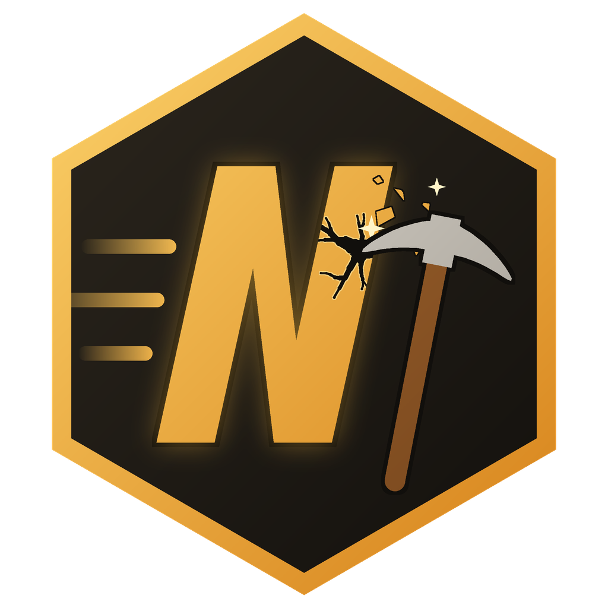

# NeoRiders Nackl Digger

A small Windows desktop app for mining NACKL with the [Acki Nacki Bee Engine](https://dev.ackinacki.com/bee-engine/bee-engine-overview).

**Every tap is a real click.** You dig on a honeycomb pad; only genuine user input counts (synthetic events are ignored, clicks faster than 90 ms are dropped). There is no auto-tapper.

<p align="center"></p>

## How it works

1. **Connect your AN Wallet** via BeeConnect (scan the QR code, confirm the connection, then confirm the mining key) – or via direct link with your wallet name.
2. **Switch digging on.** The app reads the current reward epoch (1000 blocks) from the chain.
3. **Click.** Your first click starts a Bee Engine session; each click is passed to `add_tap()`. After ~130 s (or when 70 taps and the full duration are reached) the session is stopped and the Bee Engine submits root + proof to your Miner contract.
4. The app confirms the taps against the on-chain `tap_sum` and shows the NACKL payouts (`Mining` transactions, paid out ~2 epochs later into the locked balance).

### Reward rules the app follows (from the contracts / node source)

| Limit | Value | Source |
|---|---|---|
| Taps per reward epoch | 70 | `SMALL_TAP`, `modifiers.sol` |
| Taps per 24-h epoch | 12,000 | `BIG_TAP` |
| Mining duration per epoch | 330 units (1 unit = 330 ms between first and last tap → ≈109 s) | `MINING_DUR_TAP`, `bee_verifier` |
| Reward coefficient | ≈ weighted taps × mining duration | `calc_tap_coef_with_params`, `tvm_vm/token.rs` |

So the best result per epoch is **70 clicks spread over at least ~2 minutes**. The app shows both meters while you dig.

## Privacy & security

- Your wallet's private key never leaves your phone. The app only holds its own mining key pair for its app ID.
- The mining secret and the connect-session state are stored encrypted with Windows DPAPI (`safeStorage`).
- The app talks to `mainnet.ackinacki.org` (GraphQL) and `app-backend.ackinacki.org` (wallet backend). No telemetry.

## Run from source

```bash
npm install
npm start          # development
npm run dist       # Windows x64 ZIP in dist/
```

Requires Node.js 20+. Built with Electron 37 and `@teamgosh/bee-sdk` 6.0.0.

## App ID

The app needs an `app_dapp_id` issued by the Acki Nacki team. Enter it in the Wallet panel before pairing.

## Licence

App code © NeoRider. Bee SDK: see `@teamgosh/bee-sdk` licence; Bee Engine sources: AGPL-3.0 ([gosh-sh/bee-engine](https://github.com/gosh-sh/bee-engine)).
