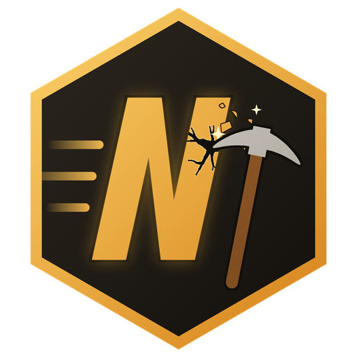
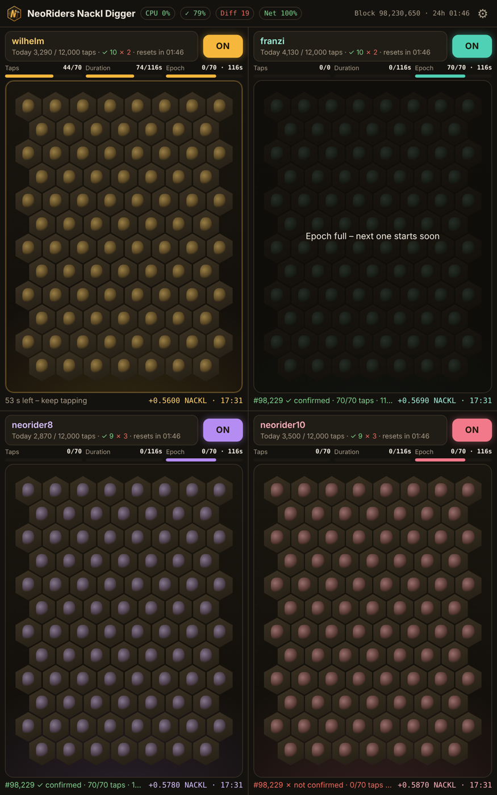
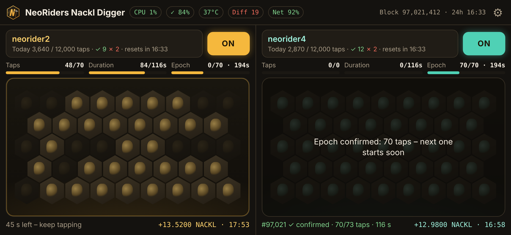

  

<h1 align="center">NeoRiders Nackl Digger</h1>

  Android app for mining <b>NACKL</b> with the Acki Nacki Bee Engine – up to four wallets, one tap pad each. 
  <b>No auto-tapper.</b> Every tap is a real finger on the screen.

  <a href="https://github.com/NeoRider12/Nackl-Digger/releases/latest"><b>⬇ Download the latest APK</b></a>

  
  

<em>Screenshots with demo values.</em>

---

## Features

- **2 or 4 tap pads**, one wallet each (4 on tablets), multi-touch
- **Pairing via BeeConnect:** scan the QR code with the AN Wallet, or use *Open in AN Wallet* on the same device
- **Epoch-aligned sessions** with on-chain confirmation and daily limit
- **Resubmission when the network is busy:** session root and proof are sent again on *queue full* (621), timeouts and gateway errors, every 3 s by default (adjustable 1–10 s), until shortly before the epoch ends
- **Two endpoints with failover:** `mainnet` and `mainnet-cf`; a slow or failing node is bypassed automatically
- **Cloudflare DNS inside the app** (DNS-over-HTTPS) – no system settings needed
- **Multi-core:** each wallet computes its proof on its own CPU core
- **Header:** CPU load, device temperature, mining difficulty, network quality, time left in the 24-h epoch
- **Per wallet:** taps today, ✓/✗ sessions, last payout with time, session history, *Restore mining*
- **Automation:** heat protection, switch off at the daily limit, optional off/on at the new 24-h epoch
- **Encrypted backup** of settings and pairings (restore after reinstalling)
- Optional screen dimming while digging, exportable log

The app ID was issued by the Acki Nacki team, and the app is shared with their permission.

## Install

1. Download `NacklDigger-v1.0.x.apk` from **[Releases](https://github.com/NeoRider12/Nackl-Digger/releases/latest)** on your Android device (Android 7 or newer).
2. Open the file. Android asks you to **allow installs from this source** (browser or file manager) – allow it once.
3. If *Google Play Protect* warns about an unknown app: tap *More details → Install anyway*. The app is not on the Play Store because Google does not allow mining apps there.
4. Optional: check the file against the `.sha256` checksum in the release.

**Update:** install the new APK over the old one – pairings and settings are kept.  
**Before uninstalling:** ⚙ → *Backup* → *Save backup to Downloads*, so you can restore everything afterwards.

## Getting started

1. Tap a pad → **Wallet Connect** → scan the QR code in the **AN Wallet** and confirm the connection and the mining key.
2. Switch the wallet **ON** and tap the pad. Up to 70 taps per epoch (~5.5 min) count; the full reward needs about 2 minutes between the first and the last tap.
3. After the session the app submits root and proof and shows the result under the pad (`✓ confirmed` or `✗ …`). Payouts arrive about two epochs later.

Tip: with several wallets, a resend interval of 2–3 s is a good balance. Running many wallets on several devices over one internet connection with 1–2 s? If the log shows frequent *429 Too Many Requests*, switch off *Cloudflare DNS* under ⚙ → Advanced options.

## Security and privacy

- Your wallet's private key **never leaves the AN Wallet**. The app only holds its own mining key pair, stored in the **Android Keystore**.
- No account, no telemetry, no ads. The app talks only to the Acki Nacki endpoints (`mainnet.ackinacki.org`, `mainnet-cf.ackinacki.org`, `app-backend.ackinacki.org`) and, for DNS, to Cloudflare (`1.1.1.1`).
- Backups are encrypted with your password (AES-256-GCM, PBKDF2). Never run the same wallet on two devices at the same time.

See [PRIVACY.md](PRIVACY.md).

## Licenses

- The app includes **Bee Engine 6.0.0** by GOSH TECHNOLOGY LTD., **modified**, licensed under the **GNU AGPL-3.0**. The modification (patch), the license text and build instructions are in [`bee-engine/`](bee-engine/).
- App code and logo © NeoRider. All rights reserved unless stated otherwise.
- Acki Nacki and NACKL are names of their respective owners. This is a community app, not an official Acki Nacki product.

## Disclaimer

Provided as is, without warranty. Mining results depend on the Acki Nacki network; under heavy load not every session gets confirmed. Use at your own risk.

---

*Older desktop version (Windows):* see the commit history of this repository.
