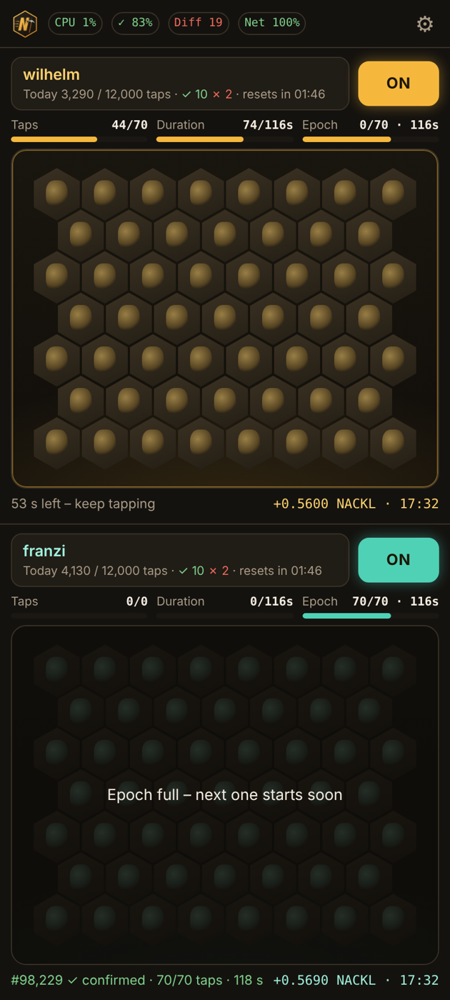
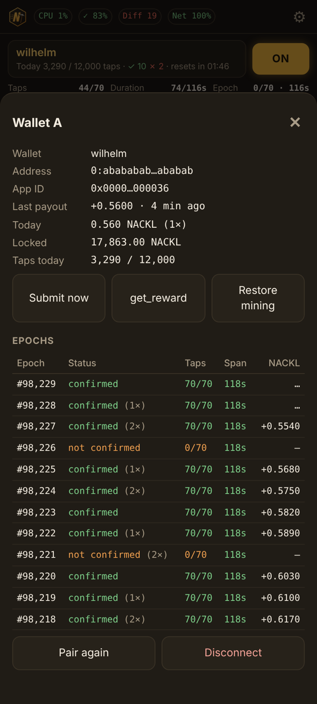

  

<h1 align="center">NeoRiders Nackl Digger</h1>

  Android app for mining <b>NACKL</b> with the Acki Nacki Bee Engine – up to <b>four wallets at once</b>, one tap pad each. 
  <b>No auto-tapper.</b> Every tap is a real finger on the screen.

  <a href="https://github.com/NeoRider12/Nackl-Digger/releases/latest"><b>⬇ Download the latest APK</b></a>
  &nbsp;·&nbsp; Android 7+ &nbsp;·&nbsp; free

  
  
  

<em>Tablet with four wallets · phone with two · wallet sheet with epochs and payouts (demo values)</em>

---

## In 60 seconds

1. **Install** the APK from [Releases](https://github.com/NeoRider12/Nackl-Digger/releases/latest).
2. **Pair** your AN Wallet: tap a pad → *Wallet Connect* → confirm the connection and the mining key in the AN Wallet.
3. **Switch the wallet ON and tap.** 70 taps over about 2 minutes count per epoch (~5.5 min).
4. The app **submits** your session and shows `✓ confirmed` or `✗ …` under the pad. **NACKL arrives** in your wallet a few minutes later – the app even claims it for you.

## Features

**Mining**
- **2 or 4 tap pads**, one wallet each (4 on tablets), multi-touch
- **Multi-core:** every wallet computes its proof on its own CPU core
- **Epoch-aware:** shows taps, duration and time left in the epoch; waits for the next epoch instead of starting a session that could not finish in time

**When the network is busy**
- **Smart resubmission:** root and proof are signed once and resent unchanged on *queue full*, timeouts and gateway errors – the node recognises repeats instead of queueing copies
- **Two endpoints with failover:** `mainnet` and `mainnet-cf`
- **Self-healing:** reads the session state from the contract if the node's events don't arrive, clears a stuck session on chain before the next one, auto-restore after repeated failures

**Payouts**
- **Automatic claiming:** a confirmed epoch is only paid out with the wallet's next successful session – if that does not come in time, the app sends `get_reward` itself, so rewards don't expire
- **Per-epoch overview:** status, taps and NACKL received for every session; last payout with time on the main screen

**Comfort & safety**
- Header with CPU load, success rate, mining difficulty, network quality and device temperature
- Heat protection, daily tap limit, optional off/on at the new 24-h epoch
- **Encrypted backup** of settings and pairings (restore after reinstalling)
- Optional screen dimming while digging, exportable log

The app ID was issued by the Acki Nacki team, and the app is shared with their permission.

  

## Install

1. Download `NacklDigger-v1.0.x.apk` from **[Releases](https://github.com/NeoRider12/Nackl-Digger/releases/latest)** on your Android device.
2. Open the file. Android asks you to **allow installs from this source** (browser or file manager) – allow it once.
3. If *Google Play Protect* warns about an unknown app: tap *More details → Install anyway*. The app is not on the Play Store because Google does not allow mining apps there.
4. Optional: check the file against the `.sha256` checksum in the release.

**Update:** install the new APK over the old one – pairings and settings are kept.
**Before uninstalling:** ⚙ → *Backup* → *Save backup to Downloads*, so you can restore everything afterwards.

## FAQ

**My sessions say "not confirmed" – is the app broken?**
Most likely the network is overloaded: the nodes accept the submission but cannot process it in time. This hits every mining app equally. The *Net* badge in the header shows how many sessions currently get through. The app keeps retrying, clears leftovers and claims payouts automatically – just keep digging.

**When does NACKL arrive?**
The contract pays an epoch when the same wallet gets its next session through (from the next-but-one epoch on), usually a few minutes later. If no further session follows (wallet switched off, failures), the app sends `get_reward` within the time window. Tip: before closing the app for the night, keep it open a few minutes longer or tap `get_reward` in each wallet sheet.

**Do I have to pair again when payouts are missing?**
Usually not. *Pair again* first checks whether your mining key is still valid on chain and tells you if it is. A new pairing is only needed if the key was replaced (for example by pairing the same wallet on another device).

**Can I run the same wallet on two devices?**
No. Each wallet has one mining key per app – pairing it on a second device replaces the key of the first one.

**Many wallets / several devices on one internet connection?**
A pause of 1–3 s between resends is a good balance. If the log shows frequent *429 Too Many Requests*, switch off *Cloudflare DNS* under ⚙ → Advanced options.

**Restore mining – when?**
If a wallet keeps failing while others succeed. It clears an old session on chain and reconnects. The app also does this by itself after repeated failures.

## Security and privacy

- Your wallet's private key **never leaves the AN Wallet**. The app only holds its own mining key pair, stored in the **Android Keystore**.
- No account, no telemetry, no ads. The app talks only to the Acki Nacki endpoints (`mainnet.ackinacki.org`, `mainnet-cf.ackinacki.org`, `app-backend.ackinacki.org`) and, for DNS, to Cloudflare (`1.1.1.1`).
- Backups are encrypted with your password (AES-256-GCM, PBKDF2).

See [PRIVACY.md](PRIVACY.md).

## Feedback

Questions, bug reports, ideas: open an [issue](https://github.com/NeoRider12/Nackl-Digger/issues) or write on Telegram to **@NeoRider1**. A log helps a lot: ⚙ → *Save log to Downloads*.

## Licenses

- The app includes **Bee Engine 6.0.0** by GOSH TECHNOLOGY LTD., **modified**, licensed under the **GNU AGPL-3.0**. The modification (patch), the license text and build instructions are in [`bee-engine/`](bee-engine/).
- App code and logo © NeoRider. All rights reserved unless stated otherwise.
- Acki Nacki and NACKL are names of their respective owners. This is a community app, not an official Acki Nacki product.

## Disclaimer

Provided as is, without warranty. Mining results depend on the Acki Nacki network; under heavy load not every session gets confirmed. Use at your own risk.

---

*Older desktop version (Windows):* see the commit history of this repository.
