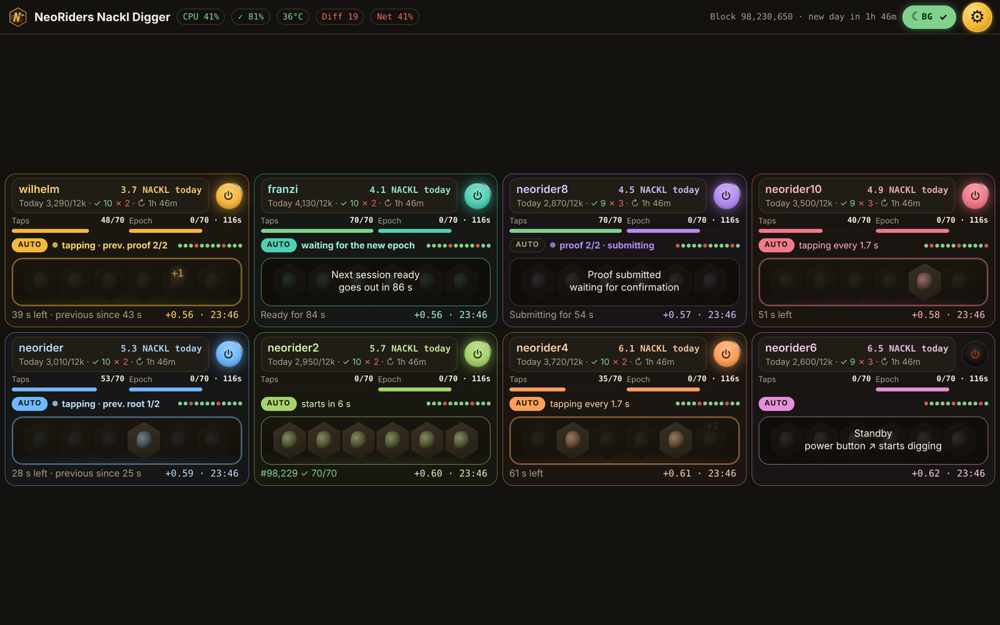
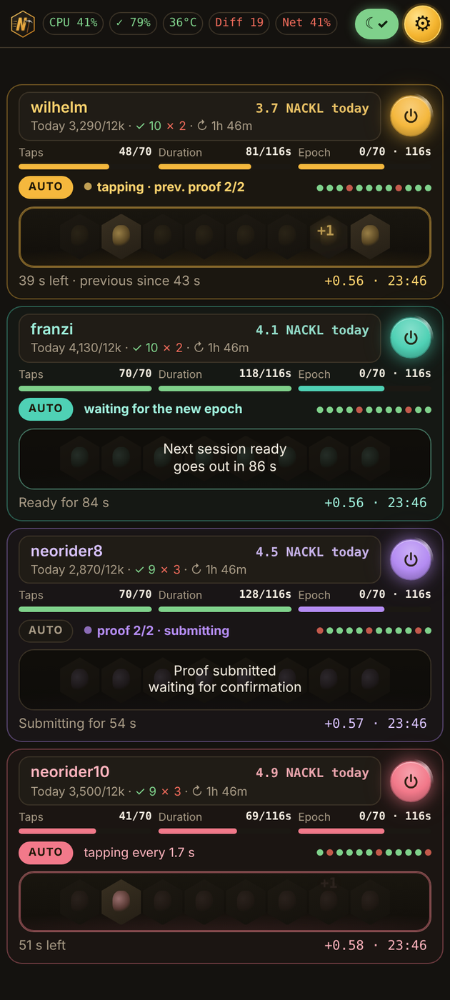
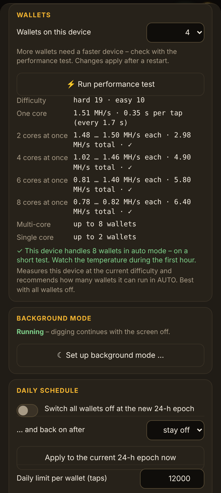
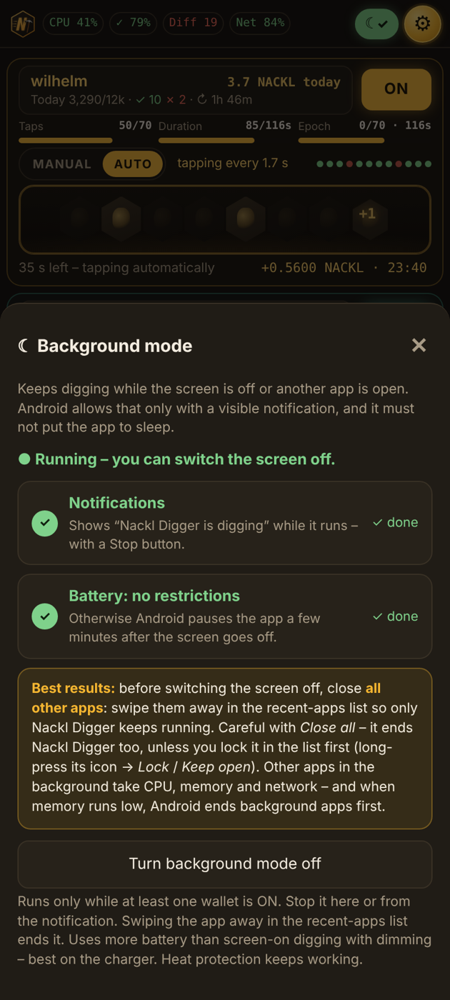
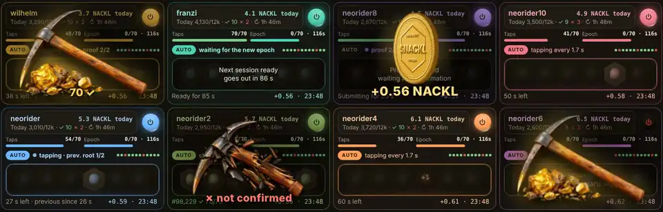
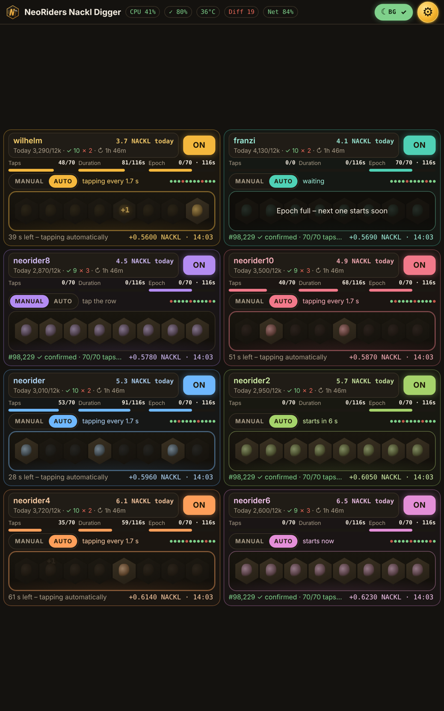
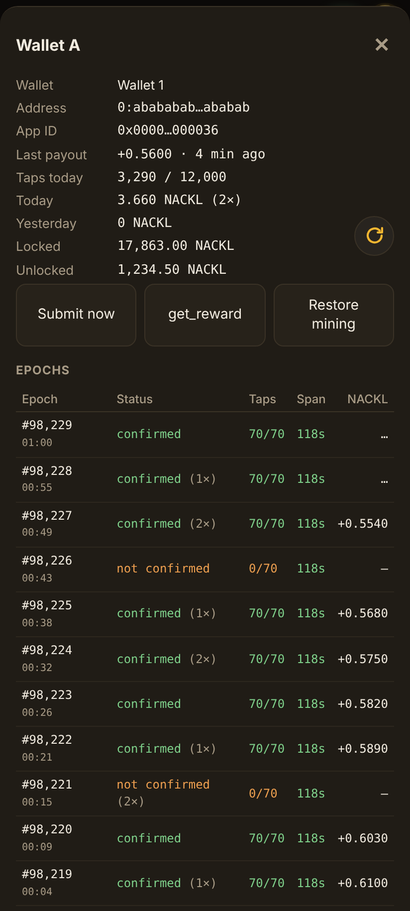

  

<h1 align="center">NeoRiders Nackl Digger</h1>

  Android app for mining <b>NACKL</b> with the Acki Nacki Bee Engine – <b>2 to 12 wallets at once</b> on one phone or tablet. 
  The app taps for you (<b>AUTO</b>), keeps digging with the screen off, and claims your rewards.

  <a href="https://github.com/NeoRider12/Nackl-Digger/releases/latest"><b>⬇ Download the latest APK</b></a>
  &nbsp;·&nbsp; Android 7+ &nbsp;·&nbsp; free

  

<em>Tablet with eight wallets in AUTO, today's NACKL next to each name (demo values)</em>

---

## Top features

- 🐝 **2, 4, 6, 8, 10 or 12 wallets on one device** – one tap row per wallet, each on its own CPU core
- 🤖 **AUTO by default** – a tap every 1.714 s per wallet, evenly spread, every tap visible in the row. Prefer your own finger? Switch the small **AUTO** button off and tap yourself
- ⏻ **A real power button per wallet** – a softly breathing red standby light when off, a shimmer in the wallet's colour when on
- 👀 **Always see what's running** – *root 1/2 · submitting*, *proof 2/2 · submitting*, *premined · ready*, also for the previous session while the next one is already being mined
- ⚡ **Performance test** in ⚙ Settings – measures your device and tells you how many wallets it can run
- 🌙 **Background mode (optional)** – reliable digging with the screen off: ☾ BG in the header, with a step-by-step setup (notifications, battery, manufacturer settings) and a notification with a Stop button
- 📶 **Network-friendly with many wallets** – staggered starts and sessions, shared status reads, smart resubmission and endpoint failover
- 💰 **Today's NACKL next to every wallet**, rewards claimed automatically, per-epoch overview of sessions and payouts
- ⛏️ **See every result at a glance** – a gold-laden pickaxe for a confirmed session, a pickaxe bursting apart in slow motion for a failed one, a spinning $NACKL coin for every payout – right in the wallet's box, no pop-up messages covering the other wallets
- 🔒 **Your wallet key never leaves the AN Wallet** – no account, no ads, no tracking

  
  
  

<em>Phone with four wallets · performance test · background mode setup (demo values)</em>

  

<em>Results right in the wallet box: confirmed · failed · payout (demo values)</em>

## In 60 seconds

1. **Install** the APK from [Releases](https://github.com/NeoRider12/Nackl-Digger/releases/latest).
2. **Pair** your AN Wallet: tap a wallet → *Wallet Connect* → confirm the connection and the mining key in the AN Wallet.
3. **Press the wallet's power button** – it starts in **AUTO** and the app taps every 1.7 s for you (70 taps over about 2 minutes count per epoch of ~5.5 min).
4. Optional: tap **☾ BG** to keep digging with the screen off, and run ⚙ → **Performance test** before adding more wallets.
5. The app **submits** each session and shows `✓ confirmed` or `✗ …`. **NACKL arrives** in your wallet a few minutes later – the app claims it for you.

## All features

**Mining**
- **2, 4, 6, 8, 10 or 12 wallets** on phones and tablets – as many as your device handles (see the performance test); tablet layouts 3 × 2 up to 4 × 3, phones scroll
- **AUTO or manual per wallet** – one small AUTO toggle; AUTO is the default and has no knobs to get wrong, switched off you tap yourself
- **Power button per wallet** (top right): red standby glow when off, wallet-coloured shimmer when on, a fast-running ring while a restore runs
- **Clear status lines:** next to AUTO the current step (*root 1/2 · submitting*, *root ✓ · waiting for interval*, *proof 2/2 · submitting*, *premined · ready*, or *tapping · prev. proof 2/2* while the previous session is still being submitted); in the tap row what is happening right now; at the bottom times and the last payout
- **Multi-core:** every wallet computes its proof on its own CPU core; the engine is compiled once for all wallets
- **Performance test:** one core, then 2/4/6/8/10/12 wallets at once, at the current difficulty – with a recommendation
- **Epoch-aware:** shows taps, duration and time left; waits for the next epoch instead of starting a session that could not finish in time
- **Premining:** the next session is mined while the previous one is still being submitted. If the previous one was credited, the next goes out right after the new epoch starts – no epoch is lost to a slow network (Bee Engine patches by the author of goblingames). A premined session that can't be used after a failure is not counted as a second failure
- **Patient submitting:** root (up to 210 s) and proof (up to 240 s) are resent unchanged, also after the epoch has ended – the session still counts

**Background mode (optional)**
- Keeps taps, submissions and reward claims running with the screen off or another app in front
- Setup sheet with checklist: notifications, *no battery restrictions*, and the exact menu path for Samsung, Xiaomi/Redmi, Huawei/Honor, Oppo/Realme/OnePlus, Vivo and Asus
- Permanent notification with live status, **Total NACKL today · yesterday** of all wallets and a Stop button; runs only while a wallet is ON

**When the network is busy**
- **Smart resubmission:** root and proof are signed once and resent unchanged on *queue full*, timeouts and gateway errors – the node recognises repeats instead of queueing copies
- **Knocks until it's in:** every submission goes to both endpoints and the active block producer at once and keeps knocking for up to 55 s; a slow answer is not cut off (it is often the one being accepted) – a new attempt simply runs alongside
- **Never stuck:** if the engine of a wallet stops answering, the session is closed and the engine rebuilt – the wallet keeps digging
- **Shared brake per device:** when *429 Too Many Requests* piles up (several devices on one connection count together), all wallets knock slower and fewer submissions run at once – back to full speed when it calms down
- **Staggered starts and sessions:** wallets don't hit the node in the same second; premined sessions go out 12–27 s after the new epoch, with a fixed offset per wallet
- **Shared reads:** identical status requests of several wallets go out once
- **Two endpoints with failover:** `mainnet` and `mainnet-cf`
- **Self-healing:** reads the session state from the contract if the node's events don't arrive, clears a stuck session on chain, auto-restore after repeated failures

**Payouts**
- **Automatic claiming:** if a confirmed epoch is not paid out with the next session in time, the app sends `get_reward` itself, so rewards don't expire – but never while a session of that wallet is being submitted, so the two can't get in each other's way
- **NACKL today** next to every wallet name (current 24-h day)
- **Per-epoch overview:** status, taps and NACKL received for every session; last payout with time on the main screen
- **Wallet sheet:** today's total, locked and unlocked balance

**Wallet effects**
- **Confirmed session:** a pickaxe with gold nuggets pulses in the wallet box, with the confirmed taps below it (`70 ✓`)
- **Failed session:** the broken pickaxe bursts apart in slow motion, with the reason below it (`✗ not confirmed`)
- **Payout:** an embossed $NACKL coin spins in the middle of the box, with the amount below it (`+0.56 NACKL`)
- Each effect runs 6 seconds; several effects of one wallet play one after another. Buttons underneath stay usable
- Pop-up messages only for things that need you, like a wallet that has to be paired again

  
  

<em>Tablet in portrait with eight wallets · wallet sheet with epochs and payouts (demo values)</em>

**Comfort & safety**
- Header with CPU load, success rate (wallets that are ON), difficulty, network quality and device temperature. *Net %* is honest: it counts every single submit answer including retries (*queue full*, 429, no answer), so it shows how tough the network really is – the ✓ rate next to it shows what still got through
- Heat protection, daily tap limit, optional off/on at the new 24-h epoch – can also be applied to the day already running
- **Encrypted backup** of settings and all pairings (restore after reinstalling)
- Optional screen dimming while digging, down to **Extreme (−100 %)**: fully black with the lowest backlight, a tap lights it up for 30 s / 1 / 5 / 15 min (ring timer in ⚙)
- Exportable log

The app ID was issued by the Acki Nacki team, and the app is shared with their permission.

## Network upgrade status

Live page showing how many Acki Nacki block keepers support the next node version, who still holds it back, when their epochs end – and **“Switch done”** as soon as the first keepers report the new version. Works for every future upgrade by itself:
**[neorider12.github.io/Nackl-Digger/upgrade.html](https://neorider12.github.io/Nackl-Digger/upgrade.html)** (data straight from `mainnet-cf.ackinacki.org/v2/bk_set_update`, refreshed every 60 s).

## Install

1. Download `NacklDigger-v1.0.x.apk` from **[Releases](https://github.com/NeoRider12/Nackl-Digger/releases/latest)** on your Android device.
2. Open the file. Android asks you to **allow installs from this source** (browser or file manager) – allow it once.
3. If *Google Play Protect* warns about an unknown app: tap *More details → Install anyway*. The app is not on the Play Store because Google does not allow mining apps there.
4. Optional: check the file against the `.sha256` checksum in the release.

**Update:** install the new APK over the old one – pairings and settings are kept.
**Before uninstalling:** ⚙ → *Backup* → *Save backup to Downloads*, so you can restore everything afterwards.

## FAQ

**AUTO or tapping yourself?**
AUTO is the easy way: press the power button and let the app dig. To tap yourself, switch the small AUTO button off. It only taps while the wallet is ON and a session can still finish in the epoch, and it stops at the network's daily limit of 12,000 taps per wallet. Run ⚙ → *Performance test* once to see how many wallets your device keeps up with.

**How many wallets can my device run?**
Open ⚙ → *Performance test* (about 20 s, best with all wallets off). It measures your device at the current difficulty and recommends how many wallets it can run (up to 12). With 8 or more wallets keep an eye on the temperature in the header during the first hour – heat protection switches wallets off if the device gets too hot.

**Can I switch the screen off?**
Yes, with ☾ **BG** (background mode) in the header. It shows a notification while it runs and asks once for notifications and *no battery restrictions*. On Xiaomi/Redmi, Samsung and some other brands also allow *Autostart* / *Never sleeping apps* – the setup sheet shows where to find it. Don't swipe the app away in the recent-apps list.

**The app keeps getting closed in the background – what can I do?**
First run ⚙ → *Background mode* setup (notifications, *no battery restrictions*, the manufacturer settings shown there). If Android still ends the app, it is usually **memory**: every wallet runs its own engine and needs its own share of RAM, so 8–12 wallets on a phone with 3–4 GB can be too much while other apps are open. **Start fewer wallets** (e.g. 4 instead of 8) and close apps you don't need. The app writes free memory to the log every few minutes (*Memory: … MB free*) and shows after a restart why Android ended it.

**My sessions say "not confirmed" – is the app broken?**
Most likely the network is overloaded: the nodes accept the submission but cannot process it in time. This hits every mining app equally. In the header, *Net* shows how tough the network is right now (every single submit answer, including *queue full* and retries) and *✓* how many sessions of the wallets that are ON got through today. The app keeps retrying, clears leftovers and claims payouts automatically – just keep digging. A premined session that had to be thrown away after a failure is not counted as a second failure.

**When does NACKL arrive?**
The contract pays an epoch when the same wallet gets its next session through (from the next-but-one epoch on), usually a few minutes later. If no further session follows (wallet switched off, failures), the app sends `get_reward` within the time window. Tip: before closing the app for the night, keep it open a few minutes longer or tap `get_reward` in each wallet sheet.

**Do I have to pair again when payouts are missing?**
Usually not. *Pair again* first checks whether your mining key is still valid on chain and tells you if it is. A new pairing is only needed if the key was replaced (for example by pairing the same wallet on another device).

**Can I run the same wallet on two devices?**
No. Each wallet has one mining key per app – pairing it on a second device replaces the key of the first one.

**Many wallets / several devices on one internet connection?**
The nodes limit requests per internet connection, and all devices on it count together. When *429 Too Many Requests* piles up, all wallets of a device slow down together by themselves (log: *Busy connection … knock slower*) and speed up again when it calms down. As a rule of thumb, about **8–10 wallets per connection** in total work best right now – more wallets often bring less, not more.

**Restore mining – when?**
If a wallet keeps failing while others succeed: wallet sheet → *Restore mining*. It clears an old session on chain and reconnects. The app also does this by itself after repeated failures, and it rebuilds a wallet's engine by itself if that stops answering.

## Security and privacy

- Your wallet's private key **never leaves the AN Wallet**. The app only holds its own mining key pair, stored in the **Android Keystore**.
- No account, no telemetry, no ads. The app talks only to the Acki Nacki endpoints (`mainnet.ackinacki.org`, `mainnet-cf.ackinacki.org`, `app-backend.ackinacki.org`) and, only if your network's DNS can't resolve them, to Cloudflare DNS (`1.1.1.1`).
- Backups are encrypted with your password (AES-256-GCM, PBKDF2).

See [PRIVACY.md](PRIVACY.md).

## Feedback

Questions, bug reports, ideas: open an [issue](https://github.com/NeoRider12/Nackl-Digger/issues) or write on Telegram to **@NeoRider1**. A log helps a lot: ⚙ → *Save log to Downloads*.

## Licenses

- The app includes **Bee Engine 6.0.0** by GOSH TECHNOLOGY LTD., **modified**, licensed under the **GNU AGPL-3.0**. The modifications (patches, three of them by the author of goblingames), the license text and build instructions are in [`bee-engine/`](bee-engine/).
- App code and logo © NeoRider. All rights reserved unless stated otherwise.
- Acki Nacki and NACKL are names of their respective owners. This is a community app, not an official Acki Nacki product.

## Disclaimer

Provided as is, without warranty. Mining results depend on the Acki Nacki network; under heavy load not every session gets confirmed. Use at your own risk.

---

*Older desktop version (Windows):* see the commit history of this repository.
